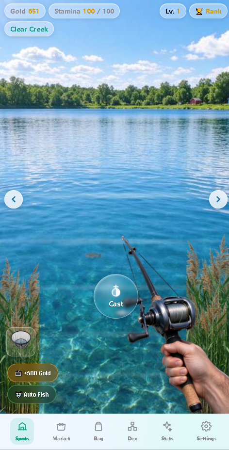

# 🎣 Chill Fishing

A relaxing, casual fishing simulation game for Android. Cast your line, reel in big catches, and build your ultimate fishing collection.

## 📥 Download APK

**[⬇️ Download ChillFishing v1.0.0 (21.4 MB)](https://github.com/mndgdd/chill-fishing/raw/refs/heads/main/apk/ChillFishing-v1.0.0.apk)**

> Supports Android 7.0+ (arm64). No account, no login, no ads interrupting your chill.

---

## 🎮 Gameplay

- **🎣 Cast & Reel** — Tap the Cast button, wait for the bite, then reel it in. Simple, satisfying, one-handed.
- **💰 Earn Gold** — Every catch puts gold in your pocket. Spend it on better rods, nets, and gear.
- **⚡ Stamina System** — Casting costs stamina. Run out? Watch a short ad or wait for it to refill.
- **🤖 Auto Fish** — Turn on Auto Fish and let the game run in the background while you relax.

## 📍 6 Scenic Fishing Spots

| Spot | Vibe |
|---|---|
| 🌊 Clear Creek | Shallow stream, small fish to start |
| 🏞️ Lake | Calm water, bass and carp |
| 🌉 River | Strong current, bigger catches |
| 🏖️ Sea | Saltwater species, tuna and marlin |
| 🛢️ Reservoir | Deep water, catfish and sturgeon |
| ✨ Mystic | Unlocks rare and legendary fish |

## 🐟 30+ Fish to Collect

From tiny minnows and crucian carp to **sharks, giant squid, marlin, swordfish, and even a whale**. Each species has its own sprite and rarity. Fill your **Dex** (collection book) to 100%!

## 🎒 Equipment & Upgrades

- **5 Rod tiers** — from basic bamboo rod to the ultimate carbon fiber rod
- **Net** — guaranteed catch when the fish is fighting hard
- **Float** — improves bite timing

## ✨ Features

- ✅ Offline play — no internet needed once installed
- ✅ No forced login, no social pressure
- ✅ Relaxing lo-fi soundtrack and ambient water sounds
- ✅ Progression that feels good, no pay-to-win
- ✅ Auto Fish mode — set it and forget it

---

## 📸 Screenshots

---

## 🛠️ Built With

- HTML5 / JavaScript game core (CreateJS)
- Wrapped into Android APK via Cordova/WebView
- Cloudflare Workers for any remote features (optional)

## 📄 License

Personal project. Download and enjoy!
